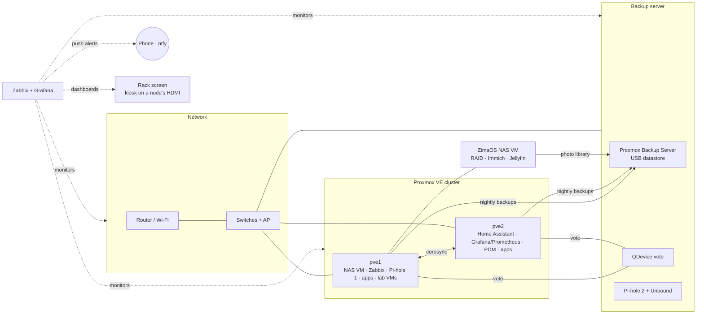

# My Homelab

A self-hosted homelab built from second-hand mini PCs. It's a two-node **Proxmox VE** cluster with a dedicated **backup server**, **highly-available ad-blocking DNS**, a **NAS** for photos and media, and full **monitoring**: a dashboard screen in the rack and push alerts to my phone.

I use it to run the services my household relies on (photos, media, DNS, home automation) and as a place to learn and practise infrastructure, networking and security skills. Each part is documented in its own repository with a full build guide, and this page ties them together.

---

## Contents
- [What it runs](#what-it-runs)
- [Architecture](#architecture)
- [Hardware](#hardware)
- [Network](#network)
- [The build, in the order I did it](#the-build-in-the-order-i-did-it)
- [Repositories](#repositories)
- [How it's kept safe](#how-its-kept-safe)
- [Biggest lessons](#biggest-lessons)
- [Roadmap](#roadmap)

---

## What it runs

| Service | What it's for | Where |
|---|---|---|
| **Pi-hole ×2 + Unbound** | Network-wide ad/tracker blocking, private recursive DNS, failover | LXC on the cluster + Docker on the backup server |
| **ZimaOS NAS** | RAID storage, SMB shares, apps | VM with a USB RAID enclosure |
| **Immich** | Self-hosted Google Photos replacement | on the NAS |
| **Jellyfin** | Personal videos and films on the TV | on the NAS |
| **Home Assistant** | Home automation | VM |
| **Audiobookshelf** | Audiobooks and podcasts | LXC |
| **Gym tracker** | A small self-hosted app for workout streaks | LXC |
| **Zabbix** | Up/down checks, SNMP, triggers, phone alerts | LXC |
| **Grafana + Prometheus** | Metrics and the rack dashboards | LXC |
| **Proxmox Backup Server** | Nightly verified backups of everything | dedicated mini PC |
| **Proxmox Datacenter Manager** | One UI for the cluster and backup server | VM |
| **Security lab** | Kali, Windows Server (AD) and a Windows 11 client for practice | VMs, started when needed |

## Architecture

## Hardware

Everything fits in a **10" mini rack** and is built from used business mini PCs, which are quiet, low-power and cheap.

| Role | Hardware | Notes |
|---|---|---|
| Hypervisor 1 (`pve1`) | HP mini PC, 6-core, **32 GB** RAM, NVMe (ZFS) | Hosts the NAS VM; the USB RAID enclosure is attached here |
| Hypervisor 2 (`pve2`) | HP mini PC, 6-core, **16 GB** RAM, NVMe (ZFS) | |
| Backup server | Lenovo ThinkCentre M700 Tiny, i5-6500T, **16 GB** RAM | 128 GB SATA SSD (OS) + USB HDD (backups) |
| NAS storage | Multi-bay USB enclosure | Software RAID, ~5.5 TB usable |
| Network | UniFi router, 2 switches, 1 access point | SNMP-monitored |
| Display | 10" HDMI screen | Driven directly by a Proxmox node |

## Network

All addresses in these repos are placeholders.

| Range | Use |
|---|---|
| `10.0.0.1` | Router / gateway |
| `10.0.0.2` | DNS 1 (Pi-hole) |
| `10.0.0.3–9` | Switches, access point |
| `10.0.0.11–12` | Proxmox nodes |
| `10.0.0.20–21` | Backup server (also DNS 2), Datacenter Manager |
| `10.0.0.30–31` | Zabbix, Grafana/Prometheus |
| `10.0.0.40+` | Apps and the NAS |

DHCP hands out both Pi-holes as DNS servers. Every server has a static IP or a DHCP reservation.

## The build, in the order I did it

1. **Proxmox cluster.** Two mini PCs, joined into a cluster. Guests can be migrated between nodes, and everything is managed from one UI. → [proxmox-cluster](https://github.com/nashibbhattrai766-max/proxmox-cluster)
2. **NAS.** ZimaOS as a VM with a USB RAID enclosure, then Immich for photos. → [zimaos-on-proxmox](https://github.com/nashibbhattrai766-max/zimaos-on-proxmox)
3. **DNS.** Pi-hole with Unbound as a private recursive resolver.
4. **Monitoring.** Zabbix built entirely through its API, then Grafana and Prometheus, then phone alerts through ntfy. → [zabbix-monitoring](https://github.com/nashibbhattrai766-max/zabbix-monitoring)
5. **The rack screen.** 17 dashboards designed for a 1280×400 display, driven from a node's HDMI port. → [grafana-rack-dashboards](https://github.com/nashibbhattrai766-max/grafana-rack-dashboards), [rack-display-kiosk](https://github.com/nashibbhattrai766-max/rack-display-kiosk)
6. **Proper backups.** A node crashed during a heavy full-copy backup window, which prompted a dedicated Proxmox Backup Server: incremental, deduplicated, verified, with automatic retention. The nightly run dropped to about 12 minutes. → [proxmox-backup-server](https://github.com/nashibbhattrai766-max/proxmox-backup-server)
7. **Surviving a node failure.** The backup server also became the cluster's QDevice, so either node can go down and the cluster keeps quorum.
8. **Photo backups.** The Immich library backs up to PBS nightly from the NAS. → [immich-pbs-backup](https://github.com/nashibbhattrai766-max/immich-pbs-backup)
9. **DNS failover.** A second Pi-hole on the backup server, kept in sync automatically. Building it uncovered that the router had been hijacking DNS. → [pihole-ha-dns](https://github.com/nashibbhattrai766-max/pihole-ha-dns)
10. **One pane of glass.** Proxmox Datacenter Manager for the cluster and backup server together. → [proxmox-datacenter-manager](https://github.com/nashibbhattrai766-max/proxmox-datacenter-manager)
11. **Media.** Jellyfin for personal videos on the TV. → [jellyfin-zimaos](https://github.com/nashibbhattrai766-max/jellyfin-zimaos)
12. **Housekeeping.** A read-only audit script for each node that finds stuck processes, dead mounts, forgotten ISOs, old snapshots and missing backups. It found two real problems on its first run.

## Repositories

| Area | Repo | Highlights |
|---|---|---|
| Virtualisation | [proxmox-cluster](https://github.com/nashibbhattrai766-max/proxmox-cluster) | 2 nodes + QDevice, node audit script, backup-age exporter, NIC hang fix |
| Backups | [proxmox-backup-server](https://github.com/nashibbhattrai766-max/proxmox-backup-server) | Full PBS build on a mini PC, retention/GC/verify, least-privilege users, monitoring |
| Backups | [immich-pbs-backup](https://github.com/nashibbhattrai766-max/immich-pbs-backup) | Photo library → PBS from an appliance NAS, in a container |
| Management | [proxmox-datacenter-manager](https://github.com/nashibbhattrai766-max/proxmox-datacenter-manager) | One UI for everything, VM script, boot fix |
| DNS | [pihole-ha-dns](https://github.com/nashibbhattrai766-max/pihole-ha-dns) | Two Pi-holes, nebula-sync, Unbound, the DNS-hijack investigation |
| Monitoring | [zabbix-monitoring](https://github.com/nashibbhattrai766-max/zabbix-monitoring) | Zabbix as code via the API, SNMP, JS preprocessing, NOC dashboard, ntfy |
| Monitoring | [grafana-rack-dashboards](https://github.com/nashibbhattrai766-max/grafana-rack-dashboards) | 17 rack-screen dashboards, one-command deploy |
| Monitoring | [rack-display-kiosk](https://github.com/nashibbhattrai766-max/rack-display-kiosk) | A Proxmox node's HDMI port as a kiosk, cross-fading rotator |
| Storage | [zimaos-on-proxmox](https://github.com/nashibbhattrai766-max/zimaos-on-proxmox) | NAS VM, USB RAID, guest-agent workaround |
| Media | [jellyfin-zimaos](https://github.com/nashibbhattrai766-max/jellyfin-zimaos) | Personal videos on Google TV |

## How it's kept safe

- **Backups:** every VM and container nightly, plus the photo library. Kept 7 daily, 4 weekly, 6 monthly. Verified weekly. Alerts if anything is older than a day or fails verification.
- **Redundancy:** two DNS servers on different machines, and a cluster that survives losing a node.
- **Least privilege:** backup clients can only add backups, not delete them. Grafana reads Zabbix through a read-only user. Datacenter Manager uses its own API tokens.
- **Monitoring:** push alerts with recovery messages, and dependencies so one outage is one notification.
- **Nothing exposed to the internet.** Every admin UI is LAN-only.
- **No secrets in git.** Scripts prompt for credentials; `.env` files are git-ignored.

## Biggest lessons

- **"High load" can mean stuck, not busy.** A retired NFS share left mounted kept the load at 10–12 on an idle CPU for days.
- **Check the network before blaming the software.** The router's ad-block feature was silently intercepting all DNS; the "working" Pi-hole was only answering from cache.
- **Backups aren't done until they're verified, pruned and monitored.**
- **Design dashboards for the screen they'll live on**, and test them there.
- **Write it down.** These repos exist so that future me can rebuild any part from scratch.

## Roadmap

- [ ] Off-site backup copy (3-2-1 rule)
- [ ] UPS with graceful shutdown
- [ ] Faster NVMe for the busier node
- [ ] Add the Home Assistant, Gym app, UniFi and security-lab write-ups

## License

MIT
