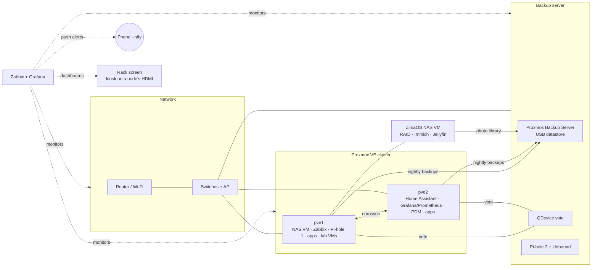

# Homelab

A self-hosted homelab built on second-hand mini PCs: a two-node Proxmox cluster, a dedicated backup server, highly-available ad-blocking DNS, a NAS for photos and media, and full monitoring with a dashboard screen in the rack and push alerts to my phone.

Everything here is documented in separate repositories so each part can be reused on its own.

## Repositories

| Area | Repo | What's inside |
|---|---|---|
| Virtualisation | [proxmox-cluster](https://github.com/nashibbhattrai766-max/proxmox-cluster) | 2-node cluster + QDevice, read-only node audit script, backup-age exporter, NIC hang fix, lessons learned |
| Backups | [proxmox-backup-server](https://github.com/nashibbhattrai766-max/proxmox-backup-server) | PBS on a ThinkCentre Tiny, USB datastore, prune/GC/verify jobs, least-privilege users, monitoring collector |
| Backups | [immich-pbs-backup](https://github.com/nashibbhattrai766-max/immich-pbs-backup) | Container that backs up a photo library to PBS nightly from an appliance NAS |
| Management | [proxmox-datacenter-manager](https://github.com/nashibbhattrai766-max/proxmox-datacenter-manager) | One UI for the cluster and backup server, VM creation script, boot fix |
| DNS | [pihole-ha-dns](https://github.com/nashibbhattrai766-max/pihole-ha-dns) | Two Pi-holes with failover, nebula-sync, Unbound recursive resolver, DNS troubleshooting |
| Monitoring | [zabbix-monitoring](https://github.com/nashibbhattrai766-max/zabbix-monitoring) | Zabbix built through its API: checks, SNMP, PBS items with JS preprocessing, NOC dashboard, ntfy alerts |
| Monitoring | [grafana-rack-dashboards](https://github.com/nashibbhattrai766-max/grafana-rack-dashboards) | 17 dashboards for a small rack screen, one-command deploy, phone alert rules |
| Monitoring | [rack-display-kiosk](https://github.com/nashibbhattrai766-max/rack-display-kiosk) | A Proxmox node's HDMI port as a kiosk (cage + Chrome) with a cross-fading rotator |
| Storage | [zimaos-on-proxmox](https://github.com/nashibbhattrai766-max/zimaos-on-proxmox) | ZimaOS as a VM with a USB RAID enclosure, guest-agent workaround, memory sizing |
| Media | [jellyfin-zimaos](https://github.com/nashibbhattrai766-max/jellyfin-zimaos) | Jellyfin for personal videos on a Google TV |

## Hardware

| Role | Hardware |
|---|---|
| Hypervisor 1 | HP mini PC, 6-core, 32 GB RAM, NVMe |
| Hypervisor 2 | HP mini PC, 6-core, 16 GB RAM, NVMe |
| Backup server | Lenovo ThinkCentre M700 Tiny, i5-6500T, 16 GB RAM, SATA SSD + USB HDD |
| NAS storage | Multi-bay USB enclosure, software RAID (~5.5 TB) |
| Network | UniFi router, two switches, one access point; 10" rack |

## Principles

- **Everything is backed up and verified.** Nightly incremental backups of every guest, a weekly integrity check, and alerts if anything is older than a day.
- **No single point of failure for the things the family notices.** Two DNS servers, a cluster that survives losing a node.
- **Monitoring tells me before anyone else does.** Push alerts with recovery messages and dependencies, so one outage is one notification.
- **Rebuildable.** Configuration is scripted and idempotent where possible.

## Notes on these repos

IP addresses, hostnames and names in these repos are placeholders (`10.0.0.x`, `pve1`, `pve2`, …). Passwords, tokens and notification topics are never stored in the scripts — they're prompted for at run time or kept in `.env` files that are git-ignored.

## License

MIT
